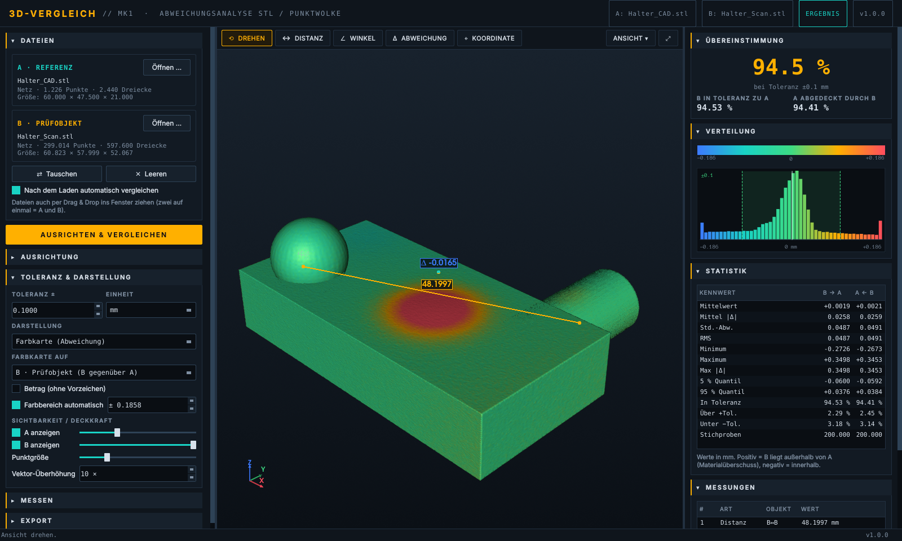

# 3D-Vergleich-MK1

Desktop-Programm (keine Web-App) zum Vergleichen von zwei 3D-Dateien – STL-Netze oder Punktwolken.
Die Dateien werden automatisch übereinandergelegt, die Abweichungen farbig dargestellt und eine
prozentuale Übereinstimmung berechnet. In der 3D-Ansicht kann innerhalb einer Datei und zwischen
beiden Dateien gemessen werden.

**Version:** 1.0.0



## Funktionen

- **Laden:** über „Öffnen …“, per Drag & Drop (zwei Dateien gleichzeitig = A und B) oder als
  Startparameter der exe.
  Formate: `STL` (binär/ASCII), `PLY`, `OBJ`, `VTP/VTK`, Punktwolken `XYZ`, `TXT`, `CSV`, `PTS`,
  `ASC`, `PCD` (ASCII/binär).
- **Automatische Ausrichtung** von B (Prüfobjekt) auf A (Referenz):
  - Grobausrichtung über Schwerpunkt und Hauptachsen (24 Lagen + Originallage werden getestet)
  - Feinausrichtung per getrimmtem ICP (robust bei Teil-Scans)
  - Punkt-zu-Ebene-ICP: genau auch bei dünn vernetzten CAD-STL und Teil-Scans
  - optional mit Skalierung (z. B. mm ↔ inch; nur bei vollständigen Objekten sinnvoll),
    alternativ „nur Feinausrichtung“ oder „keine“
- **Abweichungsdarstellung** (umschaltbar):
  - Farbkarte (vorzeichenbehaftet oder als Betrag, Bereich automatisch oder fest)
  - Toleranz-Ampel (unter / innerhalb / über Toleranz)
  - Nur außerhalb der Toleranz
  - Überlagerung mit einstellbarer Deckkraft
  - Abweichungsvektoren mit Überhöhung
  - Farbkarte wahlweise auf B oder auf A
  - Histogramm mit Toleranzband und Statistik (Mittelwert, Std.-Abw., RMS, Min/Max, Quantile …)
- **Prozentuale Übereinstimmung** bei frei wählbarer Toleranz ±:
  - „B in Toleranz zu A“ und „A abgedeckt durch B“, Gesamtwert = Mittel aus beiden
  - wird beim Ändern der Toleranz sofort neu berechnet
- **Messen** (Werkzeugleiste über der Ansicht):
  - Distanz zwischen zwei Punkten – in A, in B oder zwischen A und B (inkl. dX/dY/dZ im Tooltip)
  - Winkel über drei Punkte
  - Abweichung an einem Punkt zum jeweils anderen Objekt
  - Koordinate eines Punktes
  - optional Fang auf den nächsten echten Datenpunkt
- **Export:** Screenshot (PNG), Bericht (CSV, für Excel mit Komma-Dezimalen), Abweichung je Punkt
  (CSV), ausgerichtetes Prüfobjekt (STL/PLY/XYZ).

## Bedienung

| Aktion | Maus / Taste |
|---|---|
| Drehen | linke Maustaste ziehen |
| Verschieben | mittlere Maustaste oder Shift + links |
| Zoomen | Mausrad oder rechte Maustaste ziehen |
| Einpassen | `F` |
| Messung abbrechen / Werkzeug beenden | `Esc` |
| Markierte Messung löschen | `Entf` |

Beim Messen wird ein Punkt durch einen **Klick** gesetzt; Ziehen dreht weiterhin die Ansicht.

### Vorzeichen

Positive Abweichung = B liegt außerhalb von A (Materialüberschuss), negativ = innerhalb.
Bei Netzen wird das Vorzeichen über die Flächenorientierung bestimmt, bei Punktwolken über
geschätzte Normalen.

## Build per GitHub Actions

Der Workflow `.github/workflows/build-exe.yml` baut bei jedem Push eine einzelne
`3D-Vergleich-MK1.exe` (PyInstaller, Windows), führt vorher und nachher einen Selbsttest aus
und lädt das Ergebnis als Artefakt hoch. Bei einem Tag `v*` (z. B. `v1.0.0`) wird zusätzlich ein
Release mit der ZIP-Datei erstellt.

## Lokal starten

```bash
pip install -r requirements.txt
python run.py
```

Selbsttest ohne Oberfläche: `python tests/test_core.py` oder `3D-Vergleich-MK1.exe --selftest`.

## Projektaufbau

```
run.py                      Einstiegspunkt
3D-Vergleich-MK1.spec       PyInstaller-Konfiguration
app/
  main.py                   Start, Selbsttest
  version.py                Versionsnummer
  core/                     Laden, Ausrichtung (ICP), Abweichungen, Statistik
  ui/                       Hauptfenster, 3D-Ansicht (VTK), Design
assets/                     Programm-Icon
docs/                       Screenshot
tests/                      Selbsttest
.github/workflows/          GitHub-Actions-Build
```
